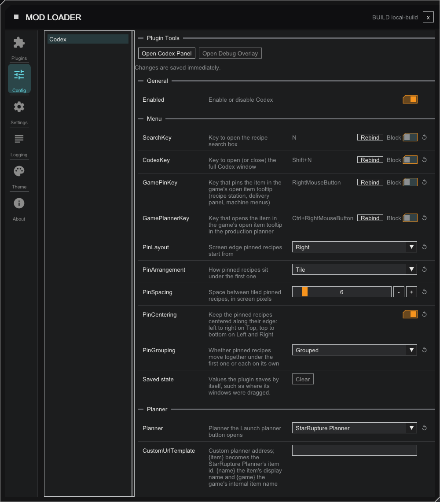

# Codex -- StarRupture Plugin

A StarRupture plugin built on the StarRupture ModLoader that adds an in-game recipe codex:
search any item or recipe and jump straight to a detail view of what it's crafted from and
what it produces.

**Target:** Game client only

**Requires:** ModLoader v1.23.0 or later (plugin interface v74). On an older
loader the plugin shows "Needs loader" and stays off.

---

## Features

- **Recipe search** -- press the configurable keybind (default `N`) to open a search box,
  type an item, recipe or building name, then use `Up`/`Down` to pick a result and `Enter`
  to open it (the top result is highlighted by default, and hovering a row highlights it
  too). Close with `Esc`. The box opens centred; drag it anywhere and it opens there next time.
- **Full Codex window** -- press `Shift+N` (configurable) to open the Codex straight to the
  last recipe you viewed, or the building browser if you haven't picked one yet.
- **Recipe detail window** -- shows a recipe's inputs and outputs side by side, each with
  icon, name, count, and craft rate (items/min). Click an input to jump to the recipe that
  produces it; click an output to see every recipe that consumes it. Click a building under
  "Made in" to browse everything that building makes.
- **Building browser** -- the Buildings tab lists every crafting building and the recipes it
  can produce. Tiered buildings are grouped under one name (e.g. "Fabricator") with a
  Tier 1 / Tier 2 tab for each tier. Click a recipe to open it, right-click to pin it.
- **Pinned recipes** -- pin up to 8 recipes to keep them on screen while you play. The first
  pin starts at the screen edge set by `PinLayout` (right, left or top) and the rest sit under
  it, set by `PinArrangement`: `Tile` (the default) lines them up edge to edge -- down a
  column for right and left, along a row for top, starting a new column or row at the screen
  margin when one fills -- with a gap between them that `PinSpacing` sets (1 to 50 screen pixels), and `Cascade`
  steps each one a title bar down and in. Pinned windows never block game input. While the
  Codex (`Shift+N`), the mod loader overlay (`F2`), the Escape menu or a game screen with the cursor is open, drag any
  pin and the whole group follows it; the move cursor shows where it can be grabbed while the Codex
  or the overlay is open (over the Escape menu the game's own cursor stays). Tile and
  Cascade each remember where you dropped the group, across sessions. Pressing and dragging
  any pin moves the whole group and keeps its layout. If you unpin the first pin, the next oldest becomes the first and takes its place. The
  recipe window's **Arrange pins** button forgets the dropped spot for the current arrangement
  and puts the pins back on the edge. Clicking a pin brings it to the front without moving
  anything. Set `PinGrouping` to `Ungrouped` and every pin is moved by hand on its own,
  and dragging one never moves another; a new pin appears where the arrangement would put it
  next to the last pin when that spot is free and on screen, else at the next free spot of the
  arrangement, else at the default spot. Switching to `Ungrouped` leaves every pin where it is;
  switching back to `Grouped` puts the rest back under the first pin, which stays where it is. Pins are saved as you pin and unpin them and come back at the next start, in the
  same order and at the same spots, once a save has finished loading and the recipe list is ready (a RELOAD of the
  plugin brings them back too). They are saved once for the game, not per save, because recipes are game-wide. A
  saved pin whose recipe the game no longer has is dropped, with a line in the log. Clicking a pin raises that window; unpinning a pin lets the others
  take its place in the stack, so the pin in front can change. With `PinCentering` on (the default) the group sits in the middle of its edge: across the top on `Top`, down the side on `Left` and `Right`, and it re-centers when a pin is added or removed. Dragging any pin then moves the group only toward or away from the edge, and Clear and the **Arrange pins** button put the group back on the edge, centered. Ungrouped pins are centered only when they are placed (a new pin, a layout switch, Arrange pins); a pin you dragged yourself stays where you put it, and after a restart saved spots count as placed by hand until Arrange pins. Changing `PinLayout` carries the pins over: Right to Left (and back) mirrors them at the same height and distance from the edge, switching to Top lines them up across the top, centered, and switching away from Top puts them at the new edge's default spot (centered along it when `PinCentering` is on). Pins that move on their own glide there in about a fifth of a second; a pin you are dragging never glides. Pins always stay fully on screen: a column or row that fills wraps to the side of the pins that has room, a cascade takes shorter steps when the first pin is near the bottom, and a saved spot is kept on screen when the resolution or window size changes. Use the X at the right end of a pin's title bar (shown while the Codex, the Escape menu or a game screen with the cursor is open) to unpin it.
- **Right-click to pin** -- right-click an item anywhere the Codex shows one (search results, a
  recipe's inputs and output, the "used in" list) to pin the recipe that makes it. In a pinned
  window, right-click an ingredient to pin its recipe too, so a production chain can be pinned
  step by step. It works wherever pins can be edited: with the Codex, the mod loader overlay (`F2`), the
  Escape menu or a game screen with the cursor open. An item whose recipe is already pinned is not added twice; items nothing makes
  (raw resources) do nothing.
- **Pin from the game's menus** -- in the recipe station, the company delivery panel or a
  machine's menu, hover an item until the game shows its tooltip, then right-click
  (`GamePinKey`) to pin the recipe that makes it. The new pin appears with the others. Only
  the item in the open tooltip is pinned, so nothing happens without one. It does nothing on
  an inventory slot's tooltip (your own inventory, or the one shown beside a machine), where
  right-click is the game's own action. A `GamePinKey` you set earlier is kept.
- **Open in Planner from the game's menus** -- on the same tooltips, **Ctrl + right-click**
  (`GamePlannerKey`) opens the production planner for that item, exactly as the Planner button
  does (it uses the `Planner` choice). The same rules as the pin apply: only items a recipe
  makes, and not on inventory slots. A plain right-click still pins and does not also open the
  planner. Clear `GamePlannerKey` to turn the planner key off.
- **Edit pins in the game's screens** -- pinned windows used to be clickable only with the
  Codex or the Escape menu open. They are now also clickable and draggable while a game screen
  shows the mouse cursor: a machine's menu, the recipe station, the corporation terminal and
  the inventory. Click a pin's X to unpin it or drag a pin to move it there; a click on a pin
  is taken by the pin, and every other click goes to the game as before. This needs the mod
  loader build that shares the mouse on game screens (the loader release after 1.22.1); on an
  older loader the pins stay as they were, editable only with the Codex, the overlay or the
  Escape menu open.
- **Planner** -- the recipe tab and every pinned window (while the Codex, the Escape menu or a game screen with the cursor is open, like
  Open) have a button that opens a production planner for the recipe's output in
  your browser. Choose the planner with `Planner`: the StarRupture Planner
  (the default) adds the item at one machine's output, starruptureplanner.com and
  starrupturecalc.com open their calculator for the item (starruptureplanner.com opens the
  item's own page for the items its calculator has no recipe for), and starrupture-planner.com
  opens its planner page (it has no item link). Items a planner does not list open it without
  an item. For any other planner, set `Planner` to `Custom` and give `CustomUrlTemplate` an
  address with `{item}`, `{name}` or `{game}`.
- **Configurable** -- enable/disable the plugin, rebind the keys and choose the pin layout
  from the mod loader's config page or config file. `Planner`, `PinLayout`, `PinArrangement`
  and `PinGrouping` are dropdowns there.

## Configuration

Settings are written to the plugin's config file on first run and can be edited there.

On the mod loader's config page, `Planner`, `PinLayout`, `PinArrangement` and `PinGrouping` are dropdowns. The search
box and pin positions have no field: the **Saved state** row at the end of the `Menu`
section has a **Clear** button that puts the search box back in the centre and the pins back
on their edge at once, even with the search box open. The saved pins are not touched, so they
still come back at the next start; only pinning and unpinning change them. The button counts the saved pins like any other saved value, so it can look enabled when only they differ from their defaults; pressing it then changes nothing. Values already in your config file
keep working, and choices match ignoring case. The dropdowns and the hidden entries need a
loader that has the Choice and Hidden config types (v71); on an older one the page shows
them as plain text fields.

| Section | Key | Default | Description |
| --- | --- | --- | --- |
| `General` | `Enabled` | `true` | Enable or disable Codex |
| `Menu` | `SearchKey` | `N` | Key to open the recipe search box |
| `Menu` | `CodexKey` | `Shift+N` | Key to open (or close) the full Codex window |
| `Menu` | `GamePinKey` | `RightMouseButton` | Key that pins the item in the game's open item tooltip (recipe station, delivery panel, machine menus) |
| `Menu` | `GamePlannerKey` | `Ctrl+RightMouseButton` | Key that opens the planner for the item in the game's open item tooltip, the same page as the Planner button |
| `Menu` | `PinLayout` | `Right` | Screen edge pinned recipes start from: `Right`, `Left` or `Top` (dropdown) |
| `Menu` | `PinArrangement` | `Tile` | How pins sit under the first one: `Tile` or `Cascade` (dropdown) |
| `Menu` | `PinGrouping` | `Grouped` | Whether pins move together under the first one or each on its own: `Grouped` or `Ungrouped` (dropdown) |
| `Menu` | `PinSpacing` | `6` | Space between tiled pins, 1 to 50 screen pixels (a slider with a number box on the config page; not scaled by the font or UI scale). Replaces the old on/off `PinGap`, which is no longer read |
| `Menu` | `PinCentering` | `true` | Keep the pinned recipes centered along their edge: left to right on Top, top to bottom on Left and Right. On: the group re-centers when a pin is added or removed, and dragging any pin moves the group only toward or away from the edge. Off: drag it anywhere. Ungrouped, it only places a pin or the whole set when you pin, change the layout, or press Arrange pins; it never moves a pin you placed by hand |
| `Menu` | `SearchBoxX` | `-1` | Search box horizontal centre as a fraction of the screen width (`-1` = centred). Set by dragging the box. No field on the config page; Clear resets it |
| `Menu` | `SearchBoxY` | `-1` | Search box top edge as a fraction of the screen height (`-1` = centred). Set by dragging the box. No field on the config page; Clear resets it |
| `Planner` | `Planner` | `StarRupture Planner` | Planner the Planner button opens: `StarRupture Planner`, `starruptureplanner.com`, `starrupturecalc.com`, `starrupture-planner.com` or `Custom` (dropdown) |
| `Planner` | `CustomUrlTemplate` | (empty) | Address used when `Planner` is `Custom`. `{item}` becomes the StarRupture Planner's item id, `{name}` the item's display name and `{game}` the game's internal item name, all URL-encoded, e.g. `https://example.com/plan?item={item}` |
| `Menu` | `PinTileOffset` | empty | Where the first pin was last dropped while tiling, as an `x,y` screen fraction. Set by dragging it. No field on the config page; Clear resets it |
| `Menu` | `PinFreeOffsets` | empty | Where each pin was last placed while ungrouped, as `x,y` screen fractions separated by `;`, in pin order. Set by dragging a pin or pinning one; the first pin's spot is used again for the next first pin. No field on the config page; Clear resets it and puts the pins where they would go if just pinned |
| `Menu` | `PinnedRecipe1` to `PinnedRecipe8` | empty | The asset name of each pinned recipe, one entry per pin, in pin order (empty = no pin in that slot). Written when a recipe is pinned or unpinned, and read once a save has finished loading to pin them again. One entry each because the config page keeps up to 255 characters per value, which eight long names in a single value could overrun. Saved for the game, not per save. No field on the config page; Clear leaves them alone and the pins stay up |
| `Menu` | `PinnedRecipes` | empty | Old single-value save of the pinned recipes, from earlier test builds. Read once at start to copy its pins to `PinnedRecipe1` to `PinnedRecipe8`, then emptied; unused afterwards |
| `Menu` | `PinCascadeOffset` | empty | Where the first pin was last dropped while cascading, as an `x,y` screen fraction. Set by dragging it. No field on the config page; Clear resets it |

---

## Building

1. Clone this repo (with submodules, or set `GameSDKRoot` / `PluginSDKInclude` in `Shared.props`)
2. Open `StarRupture-Plugin-Codex.sln` in Visual Studio 2022
3. Build the `Client Release` configuration (x64)
4. The output DLL is written to `build\Client Release\Plugins\Codex.dll`
5. Drop it into `Binaries\Win64\Plugins\` alongside `dwmapi.dll` and launch the game

See [PluginDevelopment.md](PluginDevelopment.md) for the full plugin API reference.

## Credits

Original mod by [@AlienXAXS](https://github.com/AlienXAXS).

Maintained by [@msantoro12](https://github.com/msantoro12).
